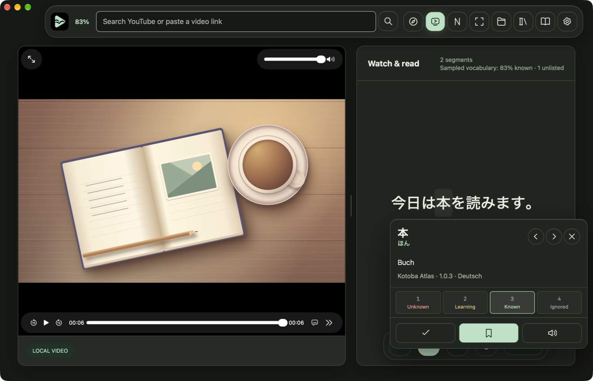
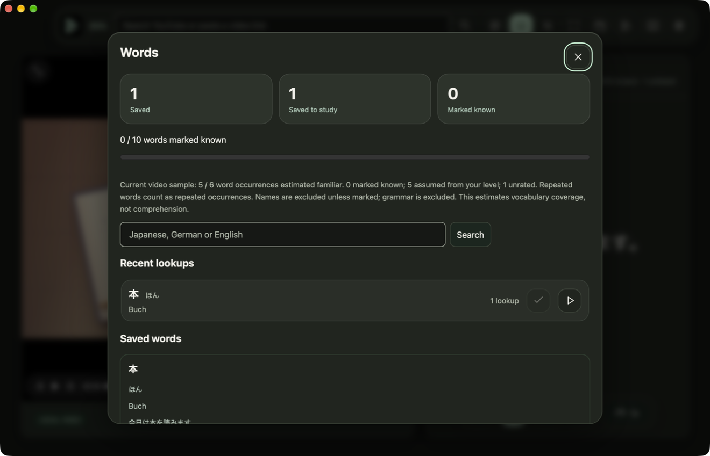

<p align="center"></p>
<h1 align="center">Immersed.</h1>
<p align="center">Learn Japanese from what you already want to watch.</p>

<p align="center">
  <a href="https://github.com/Somamill/immersed-community/releases/latest"></a>
  <a href="https://github.com/Somamill/immersed-community/releases"></a>
  <a href="https://github.com/Somamill/immersed-community/stargazers"></a>
  <a href="SUPPORT.md"></a>
  <a href="https://www.reddit.com/user/dot-app/"></a>
</p>

<p align="center">
  <a href="https://github.com/Somamill/immersed-community/releases/latest"><strong>Download for Mac</strong></a> |
  <a href="#what-you-can-do-on-mac">Mac features</a> |
  <a href="docs/MACOS.md">Mac guide</a> |
  <a href="#iphone-and-ipad">iPhone and iPad</a> |
  <a href="CHANGELOG.md">Changelog</a> |
  <a href="SUPPORT.md">Support</a>
</p>

**This repository is the open-source Immersed community edition for macOS.** The App Store editions for iPhone, iPad, and Mac are maintained separately. The full-featured Apple Silicon Mac app brings Japanese YouTube discovery, Netflix subtitle study, local video, and audiobooks into one window. Hover a word, see its reading and meaning, and get back to watching. Save the original line for review.



## What you can do on Mac

| | |
| --- | --- |
| **Find Japanese you want to hear** | Search YouTube or paste a link. Discover favors conversations, interviews, and podcasts, with filters for original Japanese, minimum duration, and Shorts. |
| **Study with Netflix subtitles** | Sign in to Netflix in Immersed and choose a subtitle track in Netflix. Use the source subtitles for hover lookup, caption navigation, and transparent fullscreen reading. Playback depends on Netflix compatibility. |
| **Open your own media** | Import videos and Japanese audiobooks, including MP4, MOV, M4B, and M4A. Books use available cover art and chapter markers. Immersed remembers your listening position and playback speed. |
| **Get Japanese captions** | Immersed uses available creator captions and compatible embedded Japanese tracks. For accessible audio without captions, on-device Whisper on Apple Silicon can prepare timed text. Long recordings prioritize the section you’re listening to. |
| **Stay with the scene** | Jump to the previous or next caption, replay a line, change speed, and look up words in fullscreen. Hover can pause the video and resume it when you leave. Use keyboard shortcuts or trackpad gestures for navigation. |
| **Keep what you learn** | Save words with the subtitle and source timestamp. Review recent lookups, set a word’s learning status, or preview a note before sending it to Anki Desktop through AnkiConnect. Study imported media offline and save eligible YouTube videos where permitted. |

### What Immersed handles automatically

- **Caption preparation and caching.** Prefer available Japanese source tracks, keep timings aligned, and cache captions for repeat viewing. When speech recognition is needed, prepare the playhead first, show progress, and continue filling nearby sections in the background.
- **Word boundaries, readings, and meaning.** Resolve supported inflections and compounds to dictionary forms, place readings on selected kanji, and reuse cached analysis and contextual rankings.
- **Resume and vocabulary history.** Restore local playback position and rate, reuse saved audiobook chapter information, keep recent lookups, and preserve the original sentence on saved words.
- **Playback and navigation.** Pause for lookup when configured, resume only if Immersed paused playback, and hide fullscreen controls when they’re idle. The startup animation respects Reduce Motion.

Search vocabulary in Japanese, English, or German. Choose the dictionary language, caption and speech options, learning level, highlighting, pitch accent, and supported web preferences in Settings. Export or import a local JSON backup of settings and words. Install dictionary updates from Settings.

[Mac controls, file formats, and compatibility](docs/MACOS.md) · [Anki and platform coverage](docs/PLATFORMS.md)

## A dictionary built for Japanese subtitles

- **Look up what was actually written.** Immersed groups Japanese compounds and common conjugations while preserving the original caption. Lookups can show the dictionary form, reading, grammar, and optional pitch accent.
- **Find the sense that fits the line.** <a href="https://github.com/Somamill/kotoba-atlas"> Kotoba Atlas</a> offers English or German definitions. Surrounding captions, grammar, and local context ranking help pick a relevant existing sense. Other dictionary senses remain available.
- **Spend your attention on new words.** Set your JLPT level to tune highlighting and optional furigana. Known, learning, and ignored words follow your choices. The vocabulary percentage estimates familiarity with the current caption sample.
- **Keep generated text in perspective.** Compare local speech models or check generated captions against readable Japanese text on the video when available. Speech recognition and dictionary rankings can still make mistakes.



Screenshots from the native Mac community app, using original sample media.

[Dictionary data and licenses](docs/DICTIONARY.md) · [Subtitle quality and test results](docs/SUBTITLE_QUALITY.md)

## Install or update on Mac

[Download the signed Apple Silicon release](https://github.com/Somamill/immersed-community/releases/latest), or install the community edition with Homebrew:

```sh
brew tap Somamill/immersed-community https://github.com/Somamill/immersed-community.git
brew install Somamill/immersed-community/immersed-mac
immersed-mac
```

For an existing stable Homebrew install:

```sh
brew untap Somamill/immersed # only if you have the old tap
brew tap Somamill/immersed-community https://github.com/Somamill/immersed-community.git
brew update
brew upgrade Somamill/immersed-community/immersed-mac
```

The app opens before optional setup. Dictionary, context and speech tools prepare when needed. Settings shows progress and lets you retry a failed setup or check for app updates. See the [Mac guide](docs/MACOS.md) for DMG runtime requirements, HEAD updates, and provider limits.

## iPhone and iPad

The separate App Store edition, **narai.**, is for videos and Japanese subtitle files you bring. Import MP4 or MOV with SRT or WebVTT, tap words for offline lookup, and save vocabulary with the original line. The streaming integrations and caption generation described above are features of the community Mac app.

[Download on the App Store](https://apps.apple.com/us/app/immersed-learn-japanese/id6834110293)

## Project and feedback

Questions, ideas, and bug reports are welcome. [Email Max](mailto:max@miller-max.com?subject=Immersed%20feedback) to open a draft, or [open a GitHub issue](https://github.com/Somamill/immersed-community/issues/new/choose).

[Support on Ko-fi](https://ko-fi.com/somamill) · [Reddit](https://www.reddit.com/user/dot-app/) · [Development](AGENTS.md) · [Privacy](PRIVACY.md) · [Store privacy policy](STORE-PRIVACY.md) · [MIT code license](LICENSE) · [Third-party credits](THIRD_PARTY.md)
